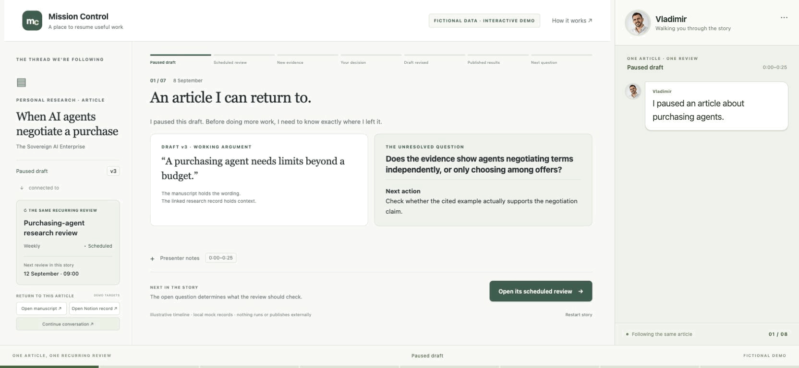

# Vladimir Stojanovski

I focus on practical enterprise AI: how useful systems are designed, governed, and made understandable to the people who use them.

My interests sit at the intersection of:

- **Enterprise AI** — connecting use cases to everyday workflows and measurable outcomes.
- **Agent architecture and governance** — clear responsibilities, review boundaries, traceable actions, and human oversight.
- **AI and data enablement** — helping people work with reliable information, explicit assumptions, and useful tools.
- **Technology sovereignty** — researching the choices that shape technological independence, capability, and control.

## A small, inspectable demonstration

**Mission Control** is a Python and SQLite reporting dashboard built around fictional records. It demonstrates atomic imports, deduplication, source freshness, missing-value handling, and separate planned, drafted, scheduled, submitted, and verified states.

The demo uses local mock adapters. It is a learning and review artifact, with no live platform integrations or production-readiness claims.

[Explore the source code, setup and tests](https://github.com/vladprosper/mission-control-demo) · [Watch or download the narrated walkthrough](mission-control-walkthrough.gif) · [Read the architecture article (Word)](The%20Architecture%20Behind%20My%20AI%20Assisted%20Work.docx) · [View the full architecture diagram](Mission%20Control%20Full%20Architecture.png)

The walkthrough follows one fictional article and its recurring research review, from a paused draft through evidence, an owner decision, later results and the next question. Its data, agent actions, platform observations and destinations are simulated.

## Writing and conversation

- [The Sovereign AI on Substack](https://thesovereignai.substack.com)
- [LinkedIn](https://www.linkedin.com/in/vlads/)
